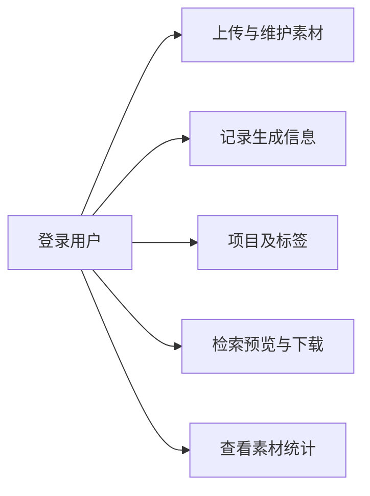

# AI 生成视频素材管理仓库需求分析

姓名　郑子渲　学号　2024337621128　班级　软件工程（1）
日期　2026 年 11 月 18 日

## 一  项目背景与范围

### 1.1 选题说明

创作者在不同 AI 视频工具中反复生成镜头后，通常会同时保留多个候选结果。仅靠文件名和文件夹，很难在几天后确认素材对应的提示词、生成模型和使用项目，也容易重复导入文件或误删可复用的镜头。

本项目拟建设面向个人创作者的 Web 素材仓库，将视频文件与生成来源、提示词、标签和项目归属一起保存。用户可以从候选视频中查找和预览素材，下载用于剪辑，并回到原始生成记录继续迭代。

### 1.2 目标用户与典型场景

目标用户是制作短视频、课程展示或视觉作品的个人创作者。需求分析暂按多账号、各账号私有管理设计。访客可访问登录页面，登录用户可维护自己的素材、项目和标签。

例如，用户为“校园宣传片”生成了三个图书馆镜头。入库时记录模型、提示词和生成时间，并归入同一项目。剪辑时按项目、镜头标签和时长筛选，对比预览后下载其中一个。几周后再次使用时，仍可找到它的生成记录和关联候选。

### 1.3 建设目标

- 找得到。标题、提示词、标签、项目和生成工具可组合检索，结果支持分页与排序。
- 追得回。每段视频都能记录生成来源和提示词，不同生成结果可以建立衍生关系。
- 用得上。视频可在浏览器预览并下载，重新登录或服务重启后仍可读取已入库的数据。

### 1.4 首期边界与待确认事项

首期输入为用户从外部工具导出的 AI 视频文件。管理闭环包括入库、补充信息、组织检索、预览下载与删除。直接调用生成模型、在线剪辑、公开素材市场、团队协作及付费功能列为后续扩展。

本次按私有仓库、项目内平级素材和手工填写生成信息确定范围。自动标签可作为选做能力。若后续确定要共同维护素材或接入视频生成 API，应再补充共享权限、生成任务、调用费用和失败重试需求。

## 二  功能性需求

### 2.1 核心模块

| 编号 | 模块 | 必须完成的行为 |
| --- | --- | --- |
| F01 | 素材入库与维护 | 上传视频，校验格式和大小，记录媒体信息，修改标题及说明，确认后删除。 |
| F02 | 生成信息追溯 | 记录来源工具、模型、提示词、生成日期和可选参数，关联同一镜头的衍生素材。 |
| F03 | 项目与标签组织 | 维护项目、标签及素材归属，一段素材可有多个标签，可随时调整分类。 |
| F04 | 检索预览与下载 | 组合查询、分页、排序、视频预览及下载原文件，展示完整素材详情。 |
| F05 | 统计与概览 | 统计素材数量、有效文件占用空间及项目分布，用列表或图表显示。 |

### 2.2 账号与访问前提

提供注册、登录和退出。用户名在系统中唯一，密码使用加盐哈希存储。登录成功后进入本人素材列表。会话失效时提示重新登录，未提交的文本信息应尽可能保留。

后端对素材详情、检索、文件预览、下载、编辑和删除逐项校验数据归属。用户修改 URL 中的素材或项目编号，也只能访问自己的资源。首期使用同一类登录用户，通过所有者字段控制访问范围。

### 2.3 入库及生成信息

上传必填项为视频文件和标题，标题去除首尾空格后为 1～100 字。首期支持单文件最大 200 MB 的 MP4 视频，实际媒体信息由后端解析。课程演示素材统一采用 H.264 视频、可选 AAC 音频，避免浏览器编码兼容性差异。

来源工具和模型可手动填写，也允许标记为“待补充”。提示词、负面提示词、种子、生成时长等参数均可缺省，页面明确显示缺失项。用户修订文字信息时更新当前记录，重新生成的视频作为另一条素材入库，再通过“衍生自”关联。

上传页面显示处理中、成功和失败三种状态。只有文件验证成功且元数据提交成功后，素材才算入库。失败时保留可重试的表单信息，并给出大小、格式或存储失败的具体提示。

## 三  用例与业务流程

### 3.1 用户与用例关系

### 3.2 UC01 上传并归档视频

前置条件为用户已登录且有可用空间。用户选取视频，填写标题，可选项目、标签和生成信息。后端校验身份、文件及项目归属，提取媒体信息并提交记录，成功后显示素材详情。

若当前用户已入库完全相同的文件，按文件摘要识别并提示打开已有素材，不重复创建。选择不存在或属于其他用户的项目时拒绝提交。文件解析或数据库写入失败时撤销本次入库并清理临时文件，重试不会留下不可见的正式素材。

### 3.3 UC02 查找并复用素材

用户输入关键词，选择项目、标签、来源工具或时长范围。关键词匹配标题、说明与提示词，其他筛选条件同时成立才返回。多个已选标签按“全部包含”匹配。列表每页默认 12 条，可选 24 条，按入库时间倒序或标题排序。

用户进入详情页查看生成记录，播放视频，拖动进度条后下载原文件。空结果提供清除筛选入口。原文件缺失时仍能看到元数据和故障提示，播放与下载应返回明确错误。

### 3.4 UC03 修改与删除

用户可调整标题、说明、项目和标签，也可补齐提示词。标签更名后关联结果同步更新。删除标签只解除该标签关联，删除项目时将其素材移至“未归档”，执行前显示影响数量并要求确认。

删除素材前显示名称及确认提示。后台先标记待删除，播放和下载停止提供文件，文件清理完成后删除记录与关联。清理失败时保留可追踪状态，允许重试，统计仅计入可用素材。

## 四  数据需求与业务规则

### 4.1 主要数据对象

| 数据对象 | 需要保存的信息 | 关联及约束 |
| --- | --- | --- |
| 用户 | 用户编号、用户名、密码哈希、创建时间。 | 用户名唯一。 |
| 素材 | 所有者、标题、说明、原文件名、内部存储键、文件摘要、大小、时长、分辨率、编码、状态及入库时间。可选衍生来源编号。 | 归属一个用户，可选一个项目，同用户的文件摘要唯一。 |
| 生成记录 | 来源工具、模型、正负提示词、生成日期、可选参数、可选来源链接。 | 与素材一对一，可补充修改。 |
| 项目 | 所有者、项目名称、说明及创建时间。 | 同一用户的项目名唯一。 |
| 标签 | 所有者、标签名及创建时间。 | 同一用户的标签名唯一，素材与标签多对多。 |
| 素材标签关联 | 素材编号、标签编号。 | 组合唯一，不能关联到其他用户的标签。 |

### 4.2 一致性规则

- 日期时间由服务端统一保存，页面按同一时区展示。生成时间允许为空，入库时间由服务端产生。
- 文件存储在受控目录，数据库记录内部存储键和元数据。文件名作为显示信息，服务器采用独立文件名，目录不能由用户指定。
- 来源链接作为文本保存。系统提供复制操作，自动抓取外链内容作为后续扩展。
- 衍生素材必须属于当前用户，不能指向自身。由于已上传视频才可被关联，新建关系时还需检查循环。
- 项目和标签的编辑、删除以及素材变更，在数据库事务中维护关联。下载时重新检查资源状态及所有者。

### 4.3 检索与统计口径

项目列表包含“未归档”入口。时长范围包含上下界，未能取得时长的素材不匹配时长条件。筛选条件改变后回到第一页，排序值相同的素材用编号作为稳定的次级排序依据。

统计只针对当前用户的可用素材。总容量为原视频文件大小之和，封面和临时文件另计。按项目统计时含“未归档”，各项数量合计应等于总素材数。不同衍生视频各算一条素材。

## 五  非功能性需求与课程约束

### 5.1 可验证的质量目标

| 编号 | 要求 | 验收方式 |
| --- | --- | --- |
| N01 | 至少适配 1366×768 桌面和 390 px 宽窄屏，表单、弹窗及主要操作可使用。 | 分别切换两种视口，检查遮挡、滚动和错误提示。 |
| N02 | 按 1000 条元数据、10 个并发用户的本地演示规模，查询响应 P95 目标不超过 2 秒。 | 固定测试数据和机器配置，测试 100 次查询，记录结果。 |
| N03 | 鉴权覆盖每项资源操作，密码哈希，参数后端复验，使用 ORM 或参数化查询。 | 用两个账号交叉请求详情、编辑、预览、下载及删除接口。 |
| N04 | 校验扩展名、媒体类型、文件大小和实际解析结果，上传失败可重试。 | 测试空文件、伪装文件、超限文件及磁盘写入失败。 |
| N05 | 业务持久化到数据库，文件及数据库一同备份，故障能给出可理解的提示。 | 重启服务后查询原素材，再从备份恢复并核对文件可播放。 |
| N06 | 日志记录用户编号、资源编号和错误原因，API 密钥使用服务端配置。 | 检查日志和公开仓库，确认密码、密钥及视频原文件不被提交。 |

### 5.2 任务书要求的落实

采用独立启动的前端和后端工程，通过 HTTP 与 JSON 通信。业务页面由前端渲染，资源归属和输入合法性由后端复验。业务记录保存到数据库，文件通过受鉴权的媒体接口预览或下载，统计结果来自持久化数据。

技术候选为 Vue 3、Element Plus、Spring Boot 3.x 与 MySQL 8.0，优先复用课程讲解的技术路线。后续选题设计文档再确定工程结构、E-R 图、字段类型和接口清单。此处技术版本沿用任务书约束。

开发阶段需提供统一错误响应、OpenAPI 文档、数据库建表与初始化脚本、README、演示账号和 Git 过程记录。教师可以根据 README 初始化数据库并复现演示。

### 5.3 AI 特色与降级

生成来源与提示词追溯是首期特色。自动标签可从标题、说明和提示词生成候选建议，用户确认后再写入。调用失败时继续使用手工标签。素材上传、查询和下载在没有外部 AI 服务时均应可用。

后续若增加视觉分析，需要先说明将发送哪些素材、发送目的和外部服务，再由用户确认触发。首期按文本元数据建议设计，避免把视频分析、生成计费和管理业务耦合。

## 六  验收场景与阶段安排

### 6.1 核心验收场景

| 场景 | 操作与输入 | 预期结果 |
| --- | --- | --- |
| AC01 | 登录后上传有效 MP4，填写项目、提示词和标签。 | 生成一条可预览记录，各项信息能在详情页读取。 |
| AC02 | 上传相同文件，再上传同一镜头的不同生成结果。 | 相同文件提示已存在，不同文件可入库并建立衍生关联。 |
| AC03 | 按项目、标签和关键词组合检索，切换排序及页码。 | 结果同时符合条件，分页稳定，重启后仍可查询。 |
| AC04 | 预览视频并拖动进度，再下载文件。 | 可正常播放和跳转，下载文件摘要与入库原文件一致。 |
| AC05 | 使用另一账号请求素材详情、下载、修改和删除。 | 后端拒绝访问，原文件和元数据不受影响。 |
| AC06 | 删除标签或项目，再删除一条素材。 | 标签关联解除；项目素材转为未归档；素材删除后不可下载。 |
| AC07 | 上传伪装 MP4、超限文件，模拟写入失败。 | 提示明确原因，没有残留的可用素材记录或临时文件。 |
| AC08 | 核对素材总数、项目分布和原文件容量。 | 数值与当前用户的可用素材一致。 |

### 6.2 工作顺序与风险处理

需求确认后，按任务书补齐《课程设计选题设计文档》，包括技术方案、E-R 图、表结构、接口清单、开发计划和 AI 使用计划，提交 Gitee 供教师审核。审核后的实现依次完成账号与持久化、上传与媒体预览、生成信息与分类检索，最后接入统计并执行上述验收场景。

风险优先处理文件与数据库一致性、浏览器编码兼容和下载鉴权。演示先统一视频编码，设置 200 MB 单文件上限，并保留临时文件清理机制。自动封面失败时展示默认封面，允许后续补充。AI 标签建议作为选做扩展。

### 6.3 当前需要确认的产品选择

当前按个人私有仓库确定用户边界，先支持导入已经生成的 MP4 视频，采用一段素材最多归属一个项目的组织方式。这三项是本次需求分析的范围假设，可在提交选题审核前调整。

资料依据　《Web系统设计与开发实践》任务书，2026/2027 学年第一学期。当前文档对应系统需求分析阶段，包含首期范围与验收要求。
